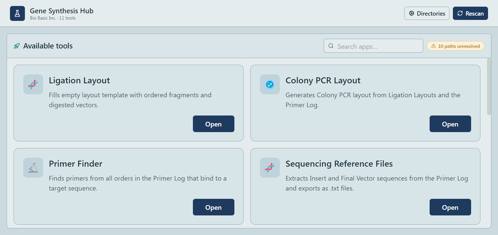

# Gene Synthesis Hub v2.1.0

**Eleven gene-synthesis tools in one portable Windows application.** Prepare ligation and colony-PCR plates, find primers, export sequencing references and order forms, organize sequencing files, prepare QC deliverables, create vector maps and generate labels or liquid-handler worklists. The catalog follows the original Gene Synthesis Hub names and order, with two columns, larger text and a muted blue-green theme.

All tool interfaces run inside Electron. Scientific, document and OCR processing uses a bundled headless Python worker where appropriate. The app starts no Streamlit server and opens no Tk windows. Extract the complete folder ZIP and double-click **Gene Synthesis Hub.exe**; users do not install Node, npm, Python or Tesseract.

## Start here

1. Extract the whole ZIP to a writable folder. Keep its `resources/` directory beside the EXE.
2. Open **Directories** to select local workbooks/folders or configure lab locations. Windows drive labels are discovered automatically; absolute paths also work.
3. Open a tool, review its inputs and choose an output folder. Missing lab paths do not prevent opening a tool and choosing local files.
4. Review the output and log before using results in the lab. Preserve `data/` when updating; it contains your directory settings. Processing logs live in `logs/`.

## Tools

| Tool | Inputs and actions | Output |
| --- | --- | --- |
| **Ligation Layout** | Job Log, fragment summary, Primer Log and bundled ligation template | Filled ligation workbook; template formatting/formulas retained |
| **Colony PCR Layout** | Ligation layout(s), Primer Log and bundled plate template; review clone counts | Colony-PCR workbook with plate positions |
| **Primer Finder** | Primer Log and pasted target DNA | Forward/reverse primer matches and CSV export; all primer rows are searched |
| **Sequencing Reference Files** | Primer Log `input addon` sheet | Insert/final-vector TXT references; conflicting duplicate filenames are rejected before writing |
| **Sequencing Order Form** | Sequencing validation workbook, Primer Log and bundled form/layout templates | Filled order form plus companion layout linked to the new form |
| **Sequencing File Organizer** | Raw reads, reference files, sorted folder and optional SG Check template | Organized AB1/FASTA files, distributed references and SG Check workbook; copies/moves are hash-verified |
| **QC File Prep** | Choose one of seven workflows below | Prepared DOCX/ZIP deliverables in a separate run folder |
| **BATCH QC Report** | Folder of BATCH ZIPs | QC report XLSX with identifiers, sequence lengths, OD readings and source images; review OCR warnings |
| **Integra Worklist** | Paste/edit bulk rows or choose single-sample wells; pooling, sorting and validation options | Worklist and sequencing-validation CSVs |
| **QC Digestion Design** | Primer Log, Work Nos and output folder | Circular GenBank maps with insert annotations, including origin-spanning inserts; optional installed-SnapGene automation |
| **Label Generator** | One or more Sg shipping-list XLS/XLSX files | Selected, deduplicated label rows copied to clipboard or saved as CSV |

Names, identifiers and workbook columns follow the reference hub. The former extra “QC Vector Map Prep” card is incorporated into **QC Digestion Design**, rather than appearing as a twelfth tool.

## QC File Prep workflows

Choose a workflow from the dropdown. Source ZIPs remain unchanged; processing uses private temporary copies and publishes into a new run folder.

| Workflow | What it does |
| --- | --- |
| **In-House New Names** | Adjusts vendor reports, inserts matching gel images or removes the digestion block, and optionally renames from the Shipment and QC Log |
| **In-House Old Names** | Applies the original WorkNo.PlasmidNo naming/report workflow |
| **Internal Renaming** | Uses a tab-separated replacement map for filenames, folders and report identifiers; optionally removes the digestion table |
| **WGK Correction** | Replaces plasmid quantity using one value or per-ID values from a tab-separated file |
| **Resuspension Prep** | Extracts identifiers, quantity and OD ratios into a DOCX table |
| **BATCH Post-Processing** | Preflights reports, asks for vector FASTA and four OD measurements, prepares customer sequence files and insert flanks, and re-zips the delivery |
| **In-House QC New (from scratch)** | Builds delivery ZIPs from Job Log rows, sorted references/reads, bundled report/PDF templates and user-provided PDF/SQD alignments |

Expand **Reference files and options** to configure Job Log, shipment log, gel image folder/ladder, sorted sequencing and image dimensions. BATCH vector and scratch alignment choices use native dialogs. **Stop** ends the owned processing worker.

## Capability limits

- DOCX reports, GenBank generation and bundled OCR work without Office or SnapGene. Legacy binary **DOC** conversion is optional and requires installed Microsoft Word. It is off by default.
- SnapGene mode automates an installed SnapGene application with keyboard/mouse controls. Keep it in front; validate the sequence against your installed version. Stop leaves SnapGene open.
- Native DOCX header handling preserves drawing geometry and normalizes text fonts. Review vendor header alignment; it does not reproduce Word COM's shape reordering/position adjustment.
- Network paths require access to the actual shares. The app cannot recreate missing logs, templates specific to your lab, gel images, instrument software or permissions.
- Worklists and labels are data exports. Physical instrument/printer operation, real lab-network runs and positive Word/SnapGene automation require target-machine acceptance.
- A completed run with review warnings may contain partial results. Inspect missing gels, skipped records and OCR readings before use. Spreadsheet formulas are retained, not evaluated by Excel inside the app.

## Development and reference updates

The reference is `BBI_projects/App_hub/Gene_Synthesis_hub` only. Original Python processing is mirrored under `python-app/Code`; native interfaces live under `src/subapps`, and headless adapters under `python-app/processors`. Adapters keep UI, staging, runtime policy and dialogs separate from upstream processing.

See [MAINTENANCE.md](MAINTENANCE.md) for a reviewed per-tool refresh and parity checks. Native JavaScript ports still require comparison when upstream processing changes; copying Python source cannot update a JavaScript implementation automatically.

Build and offline artifact checks follow [BUILD.md](BUILD.md) and the [shared build manual](../build-tools/README.md). Versions remain pinned. Development uses an isolated Sandbox; no new host toolchain is required.
