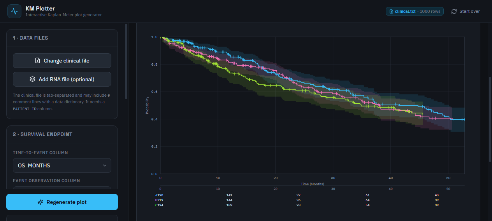

# KM Plotter

Desktop Kaplan-Meier plot generator — the Windows-native version of the
Streamlit app `003_KM_plotter` from the `Streamlit_projects` repository.

Reads a clinical dataset (and optionally an RNA expression dataset), lets you
map patient status onto a 0/1 event code, optionally splits the cohort into
subgroups, and produces interactive Kaplan-Meier curves with confidence bands,
an at-risk table, and an Excel export — all offline, in a single executable.



---

## Why Electron and not Node

`Nodejs_projects` holds web apps (Next.js) — there is no desktop packaging
story there, and a Kaplan-Meier app has to be a *local* tool that opens
files from the user's disk without a server.

`Electron_projects` already contains the exact pattern this app needs:
`003_Gene_Synthesis_Hub` and `004_Peak_Tracer` both ship a React/Electron
shell around a bundled Python runtime, producing a single portable `.exe`.
This app follows that pattern, so it inherits the repo's toolchain, its
conventions and its build pipeline.

**The statistics are not re-implemented from scratch in the UI** — the
Kaplan-Meier estimator is a faithful port of `lifelines` 0.27.8 (the version
the Streamlit app pins) written in plain NumPy, and it is validated against
real `lifelines` output on every change. See [Numerical validation](#numerical-validation).

---

## Features

| | |
|---|---|
| **Clinical input** | Tab-separated (`.txt` / `.tsv`), `#` comment lines may carry a data dictionary. `PATIENT_ID` required. |
| **RNA input** | Optional. Accepts both gene-as-rows (`Hugo_Symbol`) and patient-as-rows layouts; normalised automatically. |
| **Endpoint discovery** | Auto-detects `OS` / `RFS` / `PFS` / `DFS` / `DSS` `_MONTHS` + `_STATUS` pairs, plus `VITAL_STATUS` / `CAUSE_OF_DEATH` as alternative event sources. |
| **Event mapping** | Point-and-click mapping of raw status values onto **0 = no event** and **1 = event**, with live patient counts per value. |
| **Subgroups** | 1–5 variables × 1–5 groups. Text variables split by **tags**, numeric variables (and RNA expression) split by **ranges**. Curves are the cartesian product. |
| **Plot** | Step-function KM curves, exponential-Greenwood confidence bands, censored-observation marks, at-risk table, per-curve summary. |
| **Options** | Confidence level (90/95/99%), CI band on/off, at-risk table on/off, censor marks on/off, legend position, curve truncation (50–100%). |
| **Export** | PNG (2× retina) or SVG of the plot; Excel workbook with one sheet per curve (event table, survival function, confidence bounds, median). |

---

## Quick start

```bash
cd 005_KM_Plotter
npm install
node scripts/stage-python.js     # ~2 min: bundles CPython + installs numpy/pandas/openpyxl
npm run dev                      # dev mode (Vite + Electron)
```

### Building the Windows executable

```bash
npm run package:portable   # release/KM Plotter-1.0.0-x64.exe  (single file, ~113 MB)
npm run package:win        # NSIS installer + portable exe
```

Output lands in `release/`.

> **First launch of the portable `.exe` takes a few minutes.** electron-builder
> unpacks the whole app (the Python runtime and venv — ~15 000 files) into a
> fresh `%TEMP%` folder before the app starts. It looks like a hang; it is
> not. The `win-unpacked/` folder runs instantly and is the better artifact to
> test with.

---

## Using the app

1. **Choose clinical file…** — the only required file.
2. **Select the time-to-event column** (e.g. `OS_MONTHS`) and the **event
   observation column** (e.g. `OS_STATUS`).
3. **Map the event values** — click `0` next to every value that means *no
   event* and `1` next to every value that means *event*. Rows with an
   unmapped value are excluded from the analysis.
4. *(Optional)* **Subgroups** → *By variable(s)*: pick the dataset, the
   column and the groups. Text columns are split by tag (pick the values);
   numeric columns and RNA genes are split by range.
5. **Generate plot.**
6. **PNG** / **Excel** to save the results.

> The at-risk table and the plot's own axis are independent: the table shows
> the number at risk at five evenly spaced time points across the observed
> range, matching the Streamlit app's behaviour.

---

## Numerical validation

The KM estimator is a port of `lifelines` 0.27.8. Two test scripts prove it
is numerically identical (differences at float epsilon, ~1e-16):

```bash
# Needs a Python with lifelines installed:
pip install "lifelines==0.27.8" "pandas==2.1.4" "numpy==1.26.2" openpyxl

python tests/validate_against_lifelines.py   # estimator vs. lifelines
python tests/validate_pipeline.py             # the whole app pipeline vs. lifelines
```

`validate_pipeline.py` drives `km_core.py` exactly as Electron does and
covers: no subgroups, tag subgroups, range subgroups, the cartesian product
of two variables, real-world data with NaNs (METABRIC), non-default
confidence levels, the Excel export, and the error paths.

`npm run test:python` runs a fast smoke test against the **bundled**
runtime — no `lifelines` needed — and asserts the known-good medians.

### Verification of the shipped build

The packaged app is verified end-to-end, not just the source:

| Layer | What it proves | Result |
|---|---|---|
| L1 | Estimator ≡ lifelines 0.27.8, float epsilon | pass |
| L2 | Core works on the bundled runtime | pass |
| L3 | Real Electron IPC path, dev build | 28/28 pass |
| L3 | Real Electron IPC path, **packaged** `win-unpacked` build | 28/28 pass |
| L4 | Rendered UI inspected with real data | pass (see `docs/screenshot.png`) |

L3 runs the actual `electron/e2e.js` driver inside a real Electron instance
(file picker → job protocol → analysis → Excel export → file write), and it
resolves Python from `resources/`, the same path the shipped app uses.

---

## Architecture

```
005_KM_Plotter/
├── electron/
│   ├── main.js          # window, file dialogs, spawns the Python core
│   ├── preload.js       # the only renderer↔main surface (contextIsolation)
│   └── e2e.js           # end-to-end test driver (KM_E2E_TEST=1)
├── python-app/
│   ├── km_core.py       # CLI: inspect | analyze | export | column
│   ├── kmplot/
│   │   ├── dataio.py    # loading, column discovery, profiling
│   │   ├── kmlib.py     # the Kaplan-Meier estimator (lifelines port)
│   │   ├── analysis.py  # event encoding, subgroups, cohort construction
│   │   └── excel.py     # workbook export
│   └── requirements.txt
├── src/
│   ├── App.jsx          # the application shell and the whole flow
│   ├── components/
│   │   ├── KmPlot.jsx   # the SVG plot
│   │   ├── ui.jsx       # small UI primitives
│   │   └── ErrorBoundary.jsx
│   └── lib/plot.js      # pure plot geometry (shared by screen and export)
├── scripts/
│   ├── stage-python.js  # bundles a portable CPython + venv
│   └── test-python.js   # smoke test
└── tests/               # lifelines validation scripts
```

### How the pieces talk

The renderer never touches the filesystem. It calls `window.api.run(job)`;
the main process writes the job to a temp file and spawns
`python-app/km_core.py`, which returns a JSON result. This keeps the
renderer sandboxed, avoids shell-quoting problems with paths, and makes the
analysis trivially scriptable outside the GUI.

```
React renderer ──IPC──▶ Electron main ──spawn──▶ km_core.py ──▶ JSON result
      ▲                                                    │
      └──────────────── plot points, event table ──────────┘
```

### Why the plot is SVG

Drawing the curve with the same geometry that produces the exported file
means the PNG is exactly what was on screen. It also avoids shipping a
charting library, and lets the at-risk table, censor marks and confidence
bands share one coordinate system.

---

## Data format

Tab-separated, with an optional `#` data-dictionary header:

```
#Patient Identifier    ...    Overall Survival (Months)    Overall Survival Status
#Identifier ...                ...    Number of months          0:LIVING / 1:DECEASED
PATIENT_ID	OS_MONTHS	OS_STATUS
P_0001	33.94	Alive
```

The same three test datasets the Streamlit app uses are in the
`Streamlit_projects` repo under `Test_units/Project 003/`:

- `clinical_synthetic.txt` — 1000 patients, exercises the 9 dtype scenarios
- `clinical_METABRIC.txt` — 2509 breast-cancer patients, real NaNs
- `clinical_SIDRA-LUMC.txt` — 348 colon-cancer patients, many endpoints

---

## Notes and limitations

- **Right-censoring only.** Delayed entry (left truncation) is not supported —
  the same scope as the Streamlit app.
- **The estimator is a port, not a wrapper.** `lifelines` is a build-time
  dependency of the test suite only; the shipped app needs just NumPy,
  pandas and openpyxl. If you would rather depend on `lifelines` directly,
  `python-app/kmplot/kmlib.py` is the only file to replace.
- **Range subgroups are half-open** (`[lo, hi)`), so the last group of a
  variable catches everything that is left; no patient is silently dropped.
- **The Excel export** writes one sheet per curve with the event table,
  survival function, confidence bounds and median survival time — the same
  layout as the Streamlit app's `KM_results_XX.xlsx`.

---

## Credits

Original Streamlit app: `003_KM_plotter` (V11) by
Eduardo Reyes Alvarez, Ph.D. — `Streamlit_projects` repository.

The Kaplan-Meier estimator follows the algorithm in
[lifelines](https://github.com/CamDavidsonPilon/lifelines) 0.27.8
(Cam Davidson-Pilon), which implements the exponential-Greenwood
("log-log") confidence bounds described in R's `survival` package.
