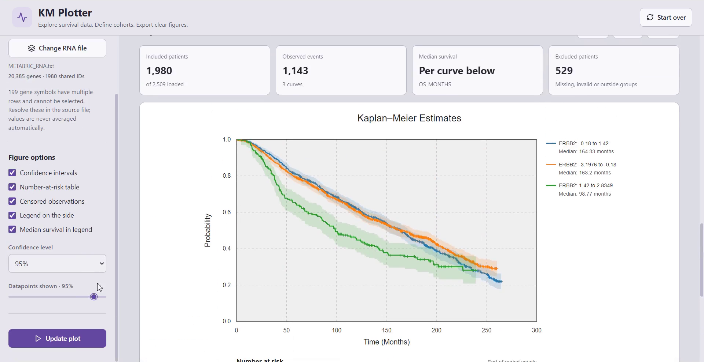

# KM Plotter

**Explore time-to-event data with local Kaplan–Meier survival plots.** Load a clinical table, inspect follow-up histograms and status counts, and explicitly assign each status to an observed event, a censored observation or an exclusion. Review the whole cohort or compare groups defined by clinical categories, numeric measurements or optional RNA-expression data.

Choose groups from visible distributions rather than guessing cutoffs. Clinical fields with a few distinct values offer category assignments with patient counts; continuous measurements and RNA genes offer signed ranges, editable boundaries and median or zero splits. Inspect included and excluded patients, event totals and per-curve median survival alongside the resulting figure.

Display confidence bands, censor marks, a readable legend and an aligned number-at-risk table. Export the same scientific figure as a high-resolution PNG or SVG, plus an Excel workbook containing event tables, survival estimates, confidence bounds and medians. Files stay local, and the portable Windows folder includes the runtimes needed to use the app without installing developer tools.



[Watch the v2.0.0 demo](../Images_GIFs_Videos/005_KM_Plotter.mp4): explore METABRIC clinical and RNA data, compare chart-guided groups and review exported figures and worksheets.

## Using the workspace

1. The app opens maximized. Choose a tab-separated clinical file with a unique, nonempty `PATIENT_ID` per row.
2. Select the follow-up time and event-status fields. Review their histogram and category counts.
3. Assign each status to **Censored / no event**, **Observed event** or **Ignore**. Totals count patients, rather than status labels. Missing/ignored statuses are excluded. Select at least one censored and one event status value.
4. Use **Whole cohort**, or choose **By variables** and add up to five subgroup variables. Patient IDs and survival endpoint fields are excluded from clinical subgroup choices.
5. Review each subgroup distribution. Assign categories to named groups, or choose signed numeric ranges with editable bounds and sliders. **One group per category**, **Split at median** and **Split at zero** appear when applicable. Each variable supports up to five groups. Names are prefilled from the variable and selected values/ranges; edit them freely. Automatic names follow selection changes, while custom names are preserved.
6. Click **Generate plot** or **Update plot**. Check included/excluded patient totals and the per-curve summary. Curves represent nonempty combinations of the groups.
7. All figure checkboxes start enabled, including the side legend, risk table and optional median line beneath each legend name. Adjust confidence level (90%, 95% or 99%), bands, censor marks, legend and displayed timeline. Analysis changes require an update before export; display-only options update immediately.
8. Save **PNG**, **SVG** or **Excel**. Success notifications disappear without moving the workspace. Errors remain visible until dismissed or corrected.

## Data and grouping rules

- **Clinical input:** UTF-8 tab-separated `.txt` / `.tsv` / `.tab`; optional `#` data-dictionary lines. Recognized endpoint pairs include OS, RFS, PFS, DFS and DSS (`_MONTHS` and `_STATUS`); `VITAL_STATUS` and `CAUSE_OF_DEATH` are alternative event sources.
- **Categories:** text and clinical numeric columns with at most ten distinct finite values use category assignments. Integers remain categorical when missing values promote their stored type to decimal. A category can belong to only one group.
- **Ranges:** continuous clinical values and all RNA genes use numeric ranges, including negative expression. Bounds normally mean `[from, to)`. **Include upper boundary** closes a range; defaults include the observed maximum in the final group. Overlaps are rejected. Missing and unselected values are excluded and counted; there is no hidden catch-all group.
- **RNA input:** gene-as-rows with `Hugo_Symbol` (and optional `Entrez_Gene_Id`), or patient-as-rows with `PATIENT_ID`. IDs match exactly after outer whitespace is removed; leading zeroes are preserved. Joins are one-to-one.
- **Gene search:** searches the complete catalog and displays up to 100 matching choices at a time. Refine the search as needed. Symbols with multiple rows are disabled and reported; values are never silently averaged or taken from the first duplicate.
- **Eligibility:** missing, nonfinite and negative follow-up times are excluded. Subgroup distributions use the eligible endpoint cohort, then report matched RNA IDs and missing/invalid measurements. Endpoint charts show raw input before mapping, so every status can be assigned deliberately.

## Figures and exports

White paper, a light gray plot field, dashed grid lines and a scientific curve palette are independent of the Iris workspace theme. Screen, SVG and PNG share the same geometry. The PNG is 3,300 pixels wide (3× the logical figure width); SVG has explicit fonts, fills and lines.

The risk table sits below the time-axis title and aligns with the displayed ticks. Each curve shows **At risk**, cumulative **Censored** and cumulative **Events**, using end-of-period counts: removals at that time are already subtracted. These differ from start-of-period counts. Displayed timeline percentage trims the figure, not the fitted cohort or Excel tables.

Excel contains one sheet per curve with event tables, survival probabilities, confidence intervals and medians. Unreached medians display as **Not reached** in the interface. Export retains the generated settings; if input files change afterward, update the plot before saving Excel. File-change detection uses path, modification time and size.

## Portable operation and development

Extract the folder ZIP and double-click its EXE. Keep the entire folder together. Node and Python are bundled; users install neither. Preserve `data/` when updating. Analysis uses one owned Python worker over local pipes, with bounded file-aware caches. There is no HTTP analysis server; normal window closure stops the worker.

Follow the [shared build manual](../build-tools/README.md). Dependency installation, development compilation and packaging run in Windows Sandbox. The release builder, from the repository root:

```powershell
powershell.exe -NoProfile -ExecutionPolicy Bypass -File .\build-tools\Build-Apps.ps1 -Apps 005_KM_Plotter
```

`src/Workspace.jsx` owns the flow; `Distribution.jsx` and `SubgroupEditor.jsx` provide chart-guided controls. `KmPlot.jsx` and `lib/figure.js` share figure geometry. `electron/python-worker.js` manages the bundled core. `kmplot/profiling.py` classifies distributions; `analysis.py` validates membership and fits the NumPy estimator.

## Validation

The estimator follows `lifelines` 0.27.8 with exponential-Greenwood (log-log) confidence bounds. Independent reference scripts compare timelines, survival, confidence bounds, medians and event tables. Set `KM_REFERENCE_DATA` to the reference clinical directory if the sibling Streamlit repo is unavailable. Reference-only dependencies belong in a disposable environment.

```powershell
python tests/validate_against_lifelines.py
python tests/validate_pipeline.py
python tests/test_v2_contract.py
node --test tests/figure-contract.cjs tests/worker-lifecycle.cjs
npm run test:python
```

`tests/ui-workflow.cjs` drives actual Electron renderer/IPC, native-dialog test hooks and bundled Python: signed RNA groups, exports, responsive layout, toast stability and worker shutdown. It requires prepared file-selection and isolated output paths; reusable setup and full reports live in Task 0001. Owner-data evidence remains outside the public repo. Development checks do not replace matching-artifact offline tests for a future release ZIP.

## Scope and limitations

- Right-censoring only; no delayed entry or left truncation.
- Descriptive curves; no Cox model, adjusted effects or hypothesis-testing workflow.
- Mandatory unique IDs; ambiguous joins and duplicated gene symbols need source-data correction.
- Many group combinations produce large figures/workbooks. Prefer focused comparisons; empty combinations are omitted.
- `lifelines` is used for independent validation, not shipped as a runtime requirement.

Original reference: Eduardo Reyes Alvarez's `Streamlit_projects/003_KM_plotter` (V11). Estimator algorithms follow [lifelines](https://github.com/CamDavidsonPilon/lifelines) 0.27.8.
