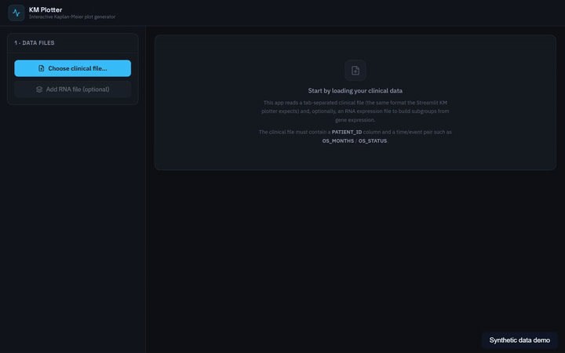
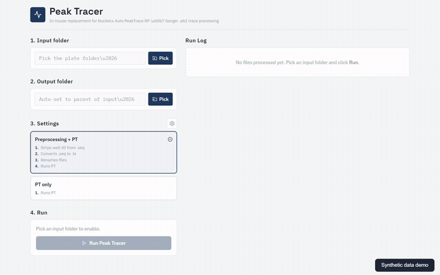
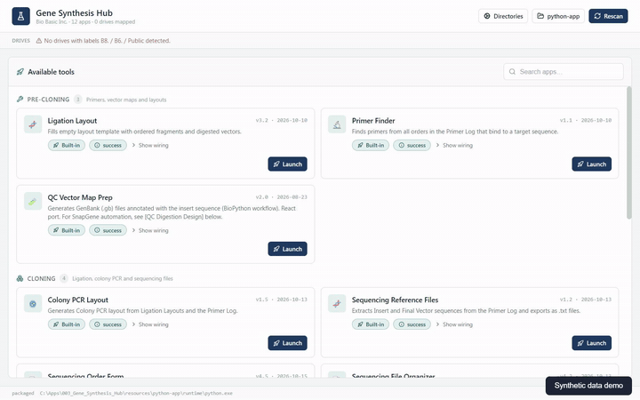
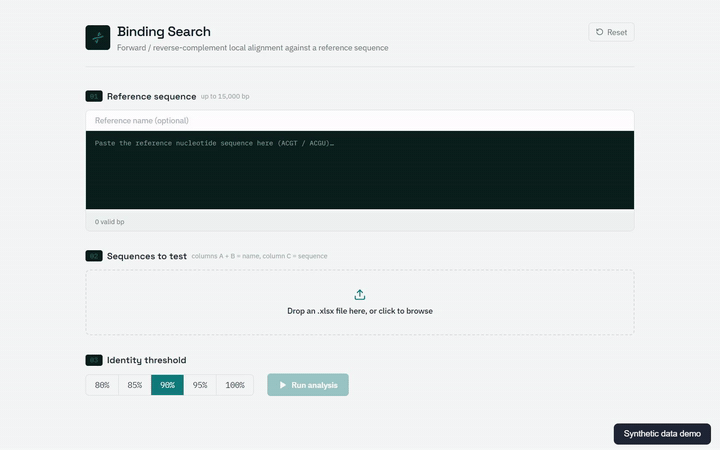
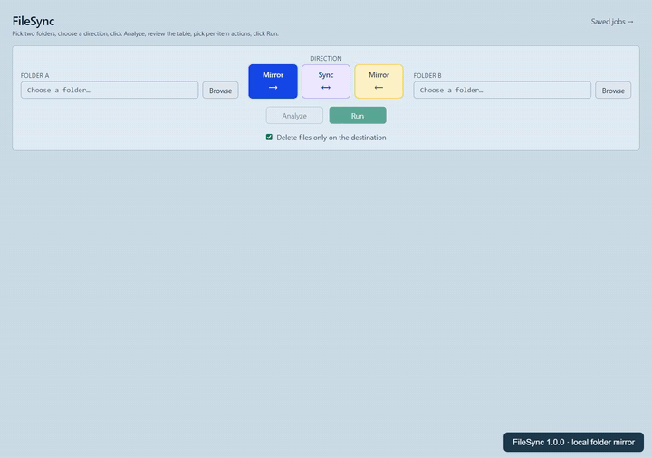

## 005 · KM Plotter

Expand this to read more...

**Summary**

**Create local Kaplan–Meier survival plots from clinical tables.** Choose the time/status fields, explicitly map event values, optionally define subgroups, and export plots and calculation results.

<video width="100%" controls autoplay loop muted playsinline preload="none" poster="Images_GIFs_Videos/005_KM_Plotter.gif" aria-label="KM Plotter recording"><source src="Images_GIFs_Videos/005_KM_Plotter.mp4" type="video/mp4"></video>

[Watch the MP4](Images_GIFs_Videos/005_KM_Plotter.mp4) · [App instructions and input format](https://github.com/EdRey05/Electron_projects/tree/main/005_KM_Plotter)

**How to use it**

1. Choose a clinical tab-separated file containing `PATIENT_ID`, a time-to-event column, and a status column. Optionally load an RNA-expression table.
2. Select the time and status columns.
3. Map status values to **0: no event/censored** and **1: observed event**.
4. Choose a whole-cohort plot or define subgroups from clinical/expression variables.
5. Generate the curve, inspect confidence intervals and the at-risk table, then export PNG or Excel results.

**In the demo**

analyze an 80-row synthetic cohort, map Alive/Dead values, render a survival curve, and export the results workbook. The example is for learning the software, not clinical decision-making.

[Sample data and example outputs](demo-data/synthetic-data-and-outputs.zip)

---

## 004 · Peak Tracer

Expand this to read more...

**Summary**

**Process Sanger AB1 traces with explicit outputs and QC information.** The pipeline retains raw acquisition evidence and inherited quality information; experimental signal-processing features have their own documented limits.

<video width="100%" controls autoplay loop muted playsinline preload="none" poster="Images_GIFs_Videos/004_Peak_Tracer.gif" aria-label="Peak Tracer recording"><source src="Images_GIFs_Videos/004_Peak_Tracer.mp4" type="video/mp4"></video>

[Watch the MP4](Images_GIFs_Videos/004_Peak_Tracer.mp4) · [App instructions and scientific notes](https://github.com/EdRey05/Electron_projects/tree/main/004_Peak_Tracer)

**How to use it**

1. Choose a folder containing `.ab1` traces.
2. Choose a separate, fresh output folder; input files should remain unchanged.
3. Select preprocessing plus PT, or **PT only**, according to your input naming/workflow.
4. Review the settings and run the batch.
5. Inspect each file's status, QC values, processing log, and generated outputs.

**In the demo**

process three synthetic 160-base chromatograms and inspect the resulting batch log/QC. Synthetic AB1 tests check file contracts and processing behavior; they are not evidence of accuracy on real sequencing runs. Read the app's scientific notes before using experimental features.

[Sample data and example outputs](demo-data/synthetic-data-and-outputs.zip)

---

## 003 · Gene Synthesis Hub

Expand this to read more...

**Summary**

**A local entry point for gene-synthesis laboratory workflows.** The catalog groups preparation, cloning, sequencing, QC/reporting, and utility tools. Some tools are implemented in React; others launch bundled Tkinter or Streamlit applications.

<video width="100%" controls autoplay loop muted playsinline preload="none" poster="Images_GIFs_Videos/003_Gene_Synthesis_Hub.gif" aria-label="Gene Synthesis Hub recording"><source src="Images_GIFs_Videos/003_Gene_Synthesis_Hub.mp4" type="video/mp4"></video>

[Watch the MP4](Images_GIFs_Videos/003_Gene_Synthesis_Hub.mp4) · [App instructions and source](https://github.com/EdRey05/Electron_projects/tree/main/003_Gene_Synthesis_Hub)

**How to use it**

1. Open **Directories** and point the needed entries at your own folders or workbooks. Company drive labels are optional when valid absolute paths are configured.
2. Search or browse the catalog and launch the tool you need.
3. Supply that tool's inputs and review its output folder before running.
4. Inspect the generated files and processing log. Directory settings persist in `data/default_directories.ini`.

Available workflows include primer lookup, vector-map preparation, ligation/colony-PCR layouts, sequencing reference files and order forms, sequencing-file organization, QC preparation/digestion, and batch reports. Their input requirements differ; the app-level instructions describe them in more detail.

**In the demo**

open **Sequencing Reference Files**, load a synthetic Primer Log workbook containing the `input addon` sheet, and export six insert/final-vector sequence files from three rows. This demonstrates one real workflow; it does not certify every Hub tool or company-data integration.

[Sample data and example outputs](demo-data/synthetic-data-and-outputs.zip)

---

## 002 · Sequence Binding Finder

Expand this to read more...

**Summary**

**Find forward and reverse-complement matches against a reference DNA sequence.** The app reports identity, orientation, positions, and a per-base alignment track.

<video width="100%" controls autoplay loop muted playsinline preload="none" poster="Images_GIFs_Videos/002_Sequence_Binding_Finder.gif" aria-label="Sequence Binding Finder recording"><source src="Images_GIFs_Videos/002_Sequence_Binding_Finder.mp4" type="video/mp4"></video>

[Watch the MP4](Images_GIFs_Videos/002_Sequence_Binding_Finder.mp4) · [App instructions and source](https://github.com/EdRey05/Electron_projects/tree/main/002_Sequence_Binding_Finder)

**How to use it**

1. Paste the reference sequence into the reference field.
2. Load a candidate `.xlsx`: columns A and B identify each entry; column C contains its sequence.
3. Choose the identity threshold and run the analysis.
4. Inspect the ranked matches and expand their alignments.
5. Save the results workbook when prompted.

**In the demo**

load three synthetic candidates, calculate forward/reverse-complement matches, inspect the results, and save the XLSX workbook. A perfect match is checked automatically.

[Sample data and example outputs](demo-data/synthetic-data-and-outputs.zip)

---

## 001 · FileSync

Expand this to read more...

**Summary**

**Review a synchronization plan before changing files.** FileSync supports one-way mirroring and bidirectional synchronization, with per-item decisions, saved jobs, and history.

<video width="100%" controls autoplay loop muted playsinline preload="none" poster="Images_GIFs_Videos/001_FileSync.gif" aria-label="FileSync recording"><source src="Images_GIFs_Videos/001_FileSync.mp4" type="video/mp4"></video>

[Watch the MP4](Images_GIFs_Videos/001_FileSync.mp4) · [App instructions and source](https://github.com/EdRey05/Electron_projects/tree/main/001_FileSync)

**How to use it**

1. Choose folders for side A and side B.
2. Choose the direction: mirror A → B, mirror B → A, or synchronize both ways.
3. Decide whether extra destination files should be deleted. Start with disposable folders when learning the workflow.
4. Click **Analyze**, review the proposed actions, and adjust any per-item choices.
5. Click **Run**, inspect the result, and save a reusable job when needed.

**In the demo**

compare a small synthetic project with an older destination copy, review differences, copy the files, and verify their contents match. The demo disables deletion of extra destination files.

[Sample data and example outputs](demo-data/synthetic-data-and-outputs.zip)

