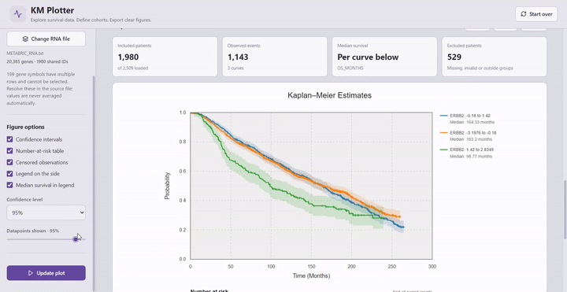
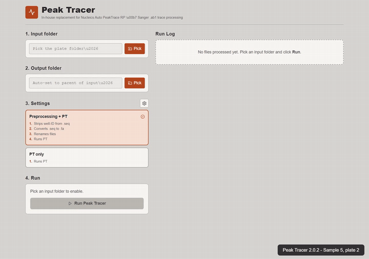
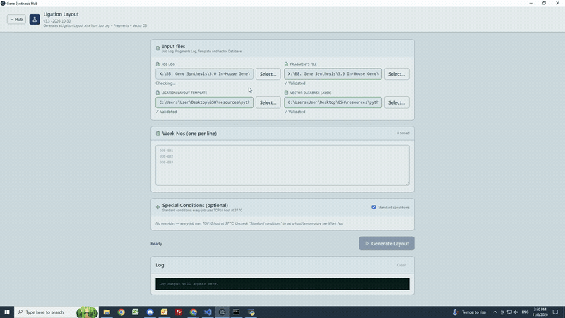
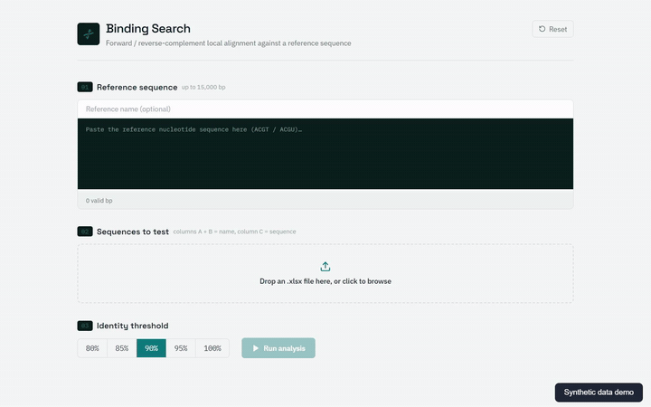
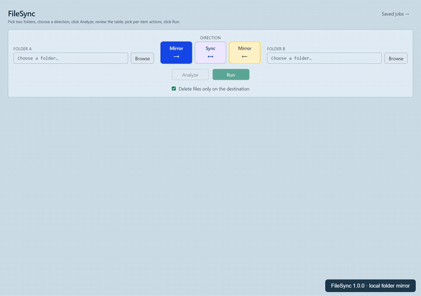

## 005 · KM Plotter

Expand this to read more...

**Summary**

**Explore time-to-event data with local Kaplan–Meier survival plots.** Load a clinical table, inspect follow-up histograms and status counts, and explicitly assign each status to an observed event, a censored observation or an exclusion. Review the whole cohort or compare groups defined by clinical categories, numeric measurements or optional RNA-expression data.

Choose groups from visible distributions rather than guessing cutoffs. Clinical fields with a few distinct values offer category assignments with patient counts; continuous measurements and RNA genes offer signed ranges, editable boundaries and median or zero splits. Inspect included and excluded patients, event totals and per-curve median survival alongside the resulting figure.

Display confidence bands, censor marks, a readable legend and an aligned number-at-risk table. Export the same scientific figure as a high-resolution PNG or SVG, plus an Excel workbook containing event tables, survival estimates, confidence bounds and medians. Files stay local, and the portable Windows folder includes the runtimes needed to use the app without installing developer tools.

<video width="100%" controls autoplay loop muted playsinline preload="none" poster="Images_GIFs_Videos/005_KM_Plotter.gif" aria-label="KM Plotter recording"><source src="Images_GIFs_Videos/005_KM_Plotter.mp4" type="video/mp4"></video>

[Watch the MP4](Images_GIFs_Videos/005_KM_Plotter.mp4) · [App instructions and input format](https://github.com/EdRey05/Electron_projects/tree/main/005_KM_Plotter)

**How to use it**

1. Choose a clinical tab-separated file containing `PATIENT_ID`, a time-to-event column, and a status column. Optionally load an RNA-expression table.
2. Select the time and status columns.
3. Assign each status to **Censored / no event**, **Observed event** or **Ignore**, checking the patient totals.
4. Choose the whole cohort or define subgroups using category counts and numeric/RNA distributions.
5. Generate the curve, inspect confidence intervals and the at-risk table, then export PNG, SVG or Excel results.

**In the demo**

Explore METABRIC clinical and matched RNA-expression data. Preview survival endpoints, split age at its median, combine age with cellularity, compare five claudin-subtype groups, and select ERBB2 from the gene catalog for three signed expression ranges. Open the exported PNG and Excel worksheets, then adjust the figure options interactively. These are exploratory, unadjusted comparisons.

[Synthetic practice data and example outputs](demo-data/synthetic-data-and-outputs.zip)

---

## 004 · Peak Tracer

Expand this to read more...

**Summary**

**Process Sanger AB1 chromatograms in local batches, with per-read results and quality information.** Select input and output folders, choose preprocessing plus trace processing or processing alone, and follow each read in the run log. The app resolves overlapping measured peaks, preserves raw acquisition evidence and inherited caller quality scores, and writes processed AB1 files, sequence exports and provenance records.

Review base counts, mean and minimum quality, ambiguous calls and reported extensions in one table. Advanced settings expose peak resolution, smoothing and naming controls. Original input files remain unchanged, and the portable Windows folder includes the runtimes needed to work offline. Signal processing does not establish improved sequencing accuracy; quality scores retain the original caller's confidence, and experimental features require validation on representative reads.

Preprocessing checks output names, uses supported companion headers and removes well-ID suffixes. Advanced controls adjust resolution strength, iterations, peak width and smoothing. Sequence exports use the computed clear range by default, and processed AB1 files are reread to verify that calls, positions and quality values match the computed results.

<video width="100%" controls autoplay loop muted playsinline preload="none" poster="Images_GIFs_Videos/004_Peak_Tracer.gif" aria-label="Peak Tracer recording"><source src="Images_GIFs_Videos/004_Peak_Tracer.mp4" type="video/mp4"></video>

[Watch the MP4](Images_GIFs_Videos/004_Peak_Tracer.mp4) · [App instructions and scientific notes](https://github.com/EdRey05/Electron_projects/tree/main/004_Peak_Tracer)

**How to use it**

1. Choose a folder containing `.ab1` traces.
2. Choose a separate, fresh output folder; input files should remain unchanged.
3. Select preprocessing plus PT, or **PT only**, according to your input naming/workflow.
4. Review the settings and run the batch.
5. Inspect each file's status, QC values, processing log, and generated outputs.

**In the demo**

Process 68 paired reads from Sample 5, plate 2. Choose the input and a separate output folder, keep **Preprocessing + PT** and the default parameters, run the complete batch, then scroll through per-read QC results. The original sample files remain unchanged. This demonstrates the local workflow, not a benchmark of sequencing accuracy; the real sample files are not distributed with the public recording.

---

## 003 · Gene Synthesis Hub

Expand this to read more...

**Summary**

**Gene Synthesis Hub v2.2.0 brings eleven gene-synthesis tools into one portable Windows application.** Prepare ligation and colony-PCR layouts, search primers, export sequencing references and order forms, organize reads, prepare QC reports and delivery ZIPs, create vector maps, and export labels or Integra worklists. The catalog follows the original hub names and order in two clear columns, with larger text and a muted blue-green theme.

The maximized workspace shows each tool’s reference version and date, with green validation checks for ready inputs. Eight QC File Prep workflows cover report preparation and checked shipment uploads; Upload Prep previews matching ZIPs and archives received originals after verified copying. Organizer can reload the last batch, Labels supports filtering and dated-folder discovery, and Integra provides sample-number, reaction-count or paste-order sorting.

Extract the complete folder ZIP and run the application without installing Node, npm, Python or Tesseract. Configure local files or lab paths through **Directories**, review results and logs, and preserve the portable data folder between updates. GenBank and DOCX processing work independently; optional legacy DOC and SnapGene automation require those installed applications. Lab-network access and physical instrument operation remain separate acceptance checks.

<video width="100%" controls autoplay loop muted playsinline preload="none" poster="Images_GIFs_Videos/003_Gene_Synthesis_Hub.png" aria-label="Gene Synthesis Hub recording"><source src="Images_GIFs_Videos/003_Gene_Synthesis_Hub.mp4" type="video/mp4"></video>

[Watch the MP4](Images_GIFs_Videos/003_Gene_Synthesis_Hub.mp4) · [App instructions and source](https://github.com/EdRey05/Electron_projects/tree/main/003_Gene_Synthesis_Hub)

**How to use it**

1. Open **Directories** and point the needed entries at your own folders or workbooks. Company drive labels are optional when valid absolute paths are configured.
2. Search or browse the catalog and launch the tool you need.
3. Supply that tool's inputs and review its output folder before running.
4. Inspect the generated files and processing log. Directory settings persist in `data/default_directories.ini`.

The eleven tools use the reference hub names and order. QC File Prep offers eight workflows in its selector; the app-level instructions describe each input and output.

**In the demo**

The owner-recorded walkthrough tours the two-column catalog, directory settings and individual tool screens, including Primer Finder, Sequencing File Organizer, QC File Prep, Integra Worklist and QC Digestion Design. It shows the workspace and controls; processing is covered separately by workbook, ZIP, reference-parity and real UI tests.

[Sample data and example outputs](demo-data/synthetic-data-and-outputs.zip)

---

## 002 · Sequence Binding Finder

Expand this to read more...

**Summary**

**Search a sequence against a reference database, or screen many candidates against one reference.** Paste one probe and load an Excel database to find matching phage, vector or host-background sequences. Switch modes to keep the original candidate-screening workflow. Both orientations are checked, and either sequence may be longer; results identify the coordinate axis, strand, hit length and probe coverage.

Choose an identity threshold from 50% to 100%, inspect ranked hits and expand per-base alignments. Mismatches appear in amber; N positions are masked from identity. Short previews keep large entries readable, and full sequences can be copied. A fixed progress area tracks the background search and keeps the controls and results heading stationary.

Load a single-record FASTA/TXT or reuse workbooks with names in columns A/B and sequence in column C. Fetch current UniVec or UniVec_Core on demand, reuse a seven-day local cache, and inspect database size and provenance. Save XLSX or CSV only when you choose; analysis never opens a save prompt. The portable Windows app includes its runtime and runs locally without Node, npm or Python installation. Sequence identity is a targeted screening aid, not binding affinity, a phage-abundance estimate or BLAST-equivalent evidence.

<video width="100%" controls autoplay loop muted playsinline preload="none" poster="Images_GIFs_Videos/002_Sequence_Binding_Finder.gif" aria-label="Sequence Binding Finder recording"><source src="Images_GIFs_Videos/002_Sequence_Binding_Finder.mp4" type="video/mp4"></video>

[Watch the MP4](Images_GIFs_Videos/002_Sequence_Binding_Finder.mp4) · [App instructions and source](https://github.com/EdRey05/Electron_projects/tree/main/002_Sequence_Binding_Finder)

**How to use it**

1. Paste the reference sequence into the reference field.
2. Load a candidate `.xlsx`: columns A and B identify each entry; column C contains its sequence.
3. Choose the identity threshold and run the analysis.
4. Inspect the ranked matches and expand their alignments.
5. Save the results workbook when prompted.

**In the demo**

Search an M13 read against 12 accession-linked references, distinguish vector and host controls, inspect a reverse-complement lambda hit, adjust the T4 threshold, and export results manually. The supplied corpus includes real reference sequences, deterministic mutated queries and one random negative control.

[Test corpus and demo inputs](002_Sequence_Binding_Finder/test_assets/README_test_assets.md)

---

## 001 · FileSync

Expand this to read more...

**Summary**

**Compare, review and synchronize two folders locally.** FileSync v1.0.0 supports one-way mirroring in either direction and bidirectional synchronization. An expandable tree shows new, changed, missing and conflicting files before you run the plan. Choose actions for one file, a whole folder or everything: copy either way, keep both versions, remove or skip.

Live Analyze counters show files, folders, discovered sizes and elapsed time. Four summary cards distinguish folder totals from pending changes. Run shows the current operation, path, completed actions and copy payload. The result check refreshes the table; a clean result turns the cards green with checkmarks. Saved jobs, per-side filters and history support recurring backups.

Copied files are independently checked with SHA-256 before replacement. Optional local trash keeps old versions and removals for recovery; expired entries are cleaned during later runs. Analyze and the final result check compare size and modification time, so unchanged files are not checksum-audited. Extract the portable Windows folder and run its EXE, with no Node, npm or Python installation; settings and logs stay beside the app.

<video width="100%" controls autoplay loop muted playsinline preload="none" poster="Images_GIFs_Videos/001_FileSync.gif" aria-label="FileSync recording"><source src="Images_GIFs_Videos/001_FileSync.mp4" type="video/mp4"></video>

[Watch the MP4](Images_GIFs_Videos/001_FileSync.mp4) · [App instructions and source](https://github.com/EdRey05/Electron_projects/tree/main/001_FileSync)

**How to use it**

1. Choose separate folders A and B; neither may contain the other.
2. Choose the direction: mirror A → B, mirror B → A, or synchronize both ways.
3. Decide whether extra destination files should be deleted. Start with disposable folders when learning the workflow.
4. Click **Analyze**, review the proposed actions, and adjust any per-item choices.
5. Click **Run**, follow the operations and result check, then inspect any remaining differences. Use saved jobs for recurring folder pairs.

**In the demo**

mirror 1,000 synthetic text files per folder, with 700 unchanged. Expand nested batches, review 300 copies/updates and 200 removals, then watch transfer progress and the checked result. Analyze playback is labeled at 1/6 speed; Run stays at normal speed.

[FileSync demo folders](demo-data/001_FileSync-inputs.zip) · [Recording recipe](demo-tools/FileSync-recording.md)

